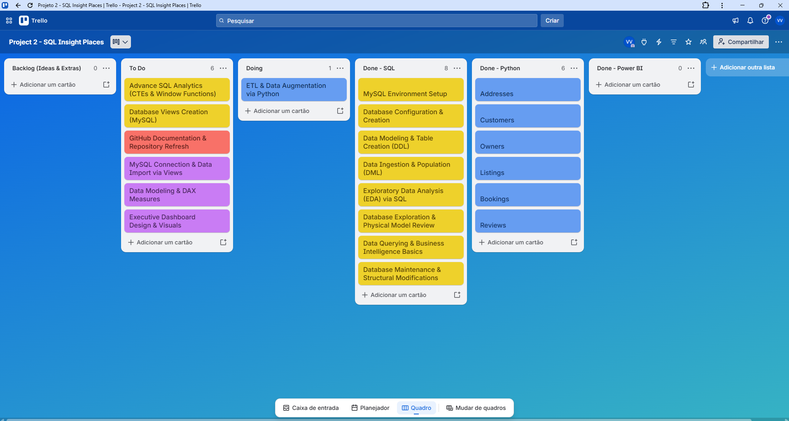

# Insight Places: Analytics Solutions & Data Pipeline 🏠📊
---

### 🌐 Select Language / Selecione o Idioma
[**English Version**](#english-version) | [**Versão em Português**](#versão-em-português)

---

## 🇺🇸 English Version

This project simulates a real data analytics ecosystem for the fictitious company **Insight Places**. The goal is to demonstrate the integration of the most robust tools in the market (SQL, Python, and Power BI) for the processing and visualization of real estate data.

For project management and task organization, I utilize the **Kanban** methodology.

🚧 **Project Status: In Development (ETL Data Augmentation & Advanced Analytics)**

🛠️ **What has been implemented so far:**

⚙️ **Data Integration & ETL (Python Layer)**
* **Robust Infrastructure:** Established a secure connection between Python and MySQL using SQLAlchemy and PyMySQL.
* **Data Wrangling:** Comprehensive processing of 6 datasets, ensuring data type consistency and correct mapping from Portuguese to English.
* **Relational Migration:** Successful upload of 9,983 records across 6 relational tables using the append strategy, ensuring special characters and line breaks (\n) were correctly interpreted by the database engine.
* **Data Augmentation (In Progress):** Developing Python scripts to enrich the MySQL database with synthetic realistic data, expanding booking history and host portfolio dynamics.
* **Security & Connectivity:** Implementation of database engine management and final backup routines.

🗄️ **Structured Database Maintenance & Analytics (SQL Layer)**
I have refactored my initial workspace queries into production-ready, modular SQL scripts to maintain a clean project architecture:
* **01_data_cleaning.sql** *(Database Reset & Referential Integrity)*: Implementation of a safe TRUNCATE workflow to reset table states before Python migrations. Post-migration cleanup includes strategic DELETE routines to remove 16 orphaned address records while respecting parent-child constraints.
* **02_data_auditory.sql** *(Data Quality & Business Rules)*: Script dedicated to validation checks, auditing hidden text line breaks (\n), identifying inactive owners (onboarding analysis), and validating 1:N relationship constraints.
* **03_occupancy_metrics.sql** *(Performance Analytics)*: Development of advanced metrics to calculate real estate occupancy rates, sorting properties by high demand (star listings) and low demand (triggering marketing and dynamic pricing actions).
* **Security & Health:** Implementation of database dependency investigations (FOREIGN KEY checks) and backup routines (Dumps).

🔍 **Next Steps:**

📊 **SQL Stage (Part 2 - Advanced Analytics)**
- [ ] Development of CTEs and Window Functions for complex business metrics (LTV, host performance, dynamic rates).
- [ ] Creation of permanent MySQL Views to optimize analytical queries.

🐍 **Python Stage (Processing & Automation)**
- [ ] Finalize automated data enrichment script for longitudinal customer records.

📈 **Power BI Stage (Strategic Insights)**
- [ ] Connection to MySQL database views via DirectQuery/Import.
- [ ] Data modeling (Star Schema) and DAX measures creation.
- [ ] Creation of an interactive Dashboard with revenue and occupancy KPIs.

---

## 🇧🇷 Versão em Português

Este projeto simula um ecossistema real de análise de dados para a empresa fictícia **Insight Places**. O objetivo é demonstrar a integração das ferramentas mais robustas do mercado (SQL, Python e Power BI) no tratamento e visualização de dados imobiliários. 

Para a gestão e organização das tarefas, utilizo a metodologia **Kanban**.

🚧 **Status do Projeto: Em Desenvolvimento (Enriquecimento de Dados em Python & Análises Avançadas)**

🛠️ **O que foi implementado até agora:**

⚙️ **Integração de Dados & ETL (Camada Python)**
* **Infraestrutura Robusta:** Estabeleci uma conexão segura entre o Python e o MySQL utilizando as bibliotecas SQLAlchemy e PyMySQL.
* **Tratamento de Dados (Data Wrangling):** Processamento completo de 6 conjuntos de dados, garantindo a consistência dos tipos de dados e o mapeamento correto dos termos do português para o inglês.
* **Migração Relacional:** Sucesso na carga de 9.983 registros distribuídos em 6 tabelas relacionais utilizando a estratégia append, garantindo que caracteres especiais e quebras de linha (\n) fossem interpretados corretamente pelo motor do banco de dados.
* **Enriquecimento de Dados (Em Andamento):** Desenvolvimento de scripts Python para enriquecer o banco de dados MySQL com massa de dados aleatória e realista, expandindo o histórico de reservas e a variação do portfólio dos proprietários.
* **Segurança & Conectividade:** Implementação do gerenciamento do motor do banco de dados e rotinas finais de backup.

🗄️ **Manutenção Estruturada & Análise de Banco de Dados (Camada SQL)**
Para garantir a organização e a clareza do projeto, dividi o fluxo de banco de dados em arquivos SQL focados em etapas específicas:
* **01_data_cleaning.sql** *(Reset do Banco & Integridade Referencial)*: Implementação de um fluxo seguro de TRUNCATE para limpar o estado das tabelas antes das migrações do Python. A limpeza pós-migração inclui rotinas estratégicas de DELETE para remover 16 registros de endereços órfãos, respeitando as restrições de chave estrangeira (pai-filho).
* **02_data_auditory.sql** *(Qualidade dos Dados & Regras de Negócio)*: Script dedicado a testes de validação, auditando quebras de linha ocultas nos textos (\n), identificando proprietários inativos (análise de engajamento no onboarding) e validando restrições de relacionamento 1:N.
* **03_occupancy_metrics.sql** *(Análise de Performance)*: Desenvolvimento de métricas avançadas para calcular a taxa de ocupação dos imóveis, ordenando as propriedades por alta demanda (anúncios "estrela") e baixa demanda (para direcionar ações de marketing e estratégias de preço dinâmico).
* **Segurança & Saúde do Banco:** Implementação de investigações de dependências de banco de dados (validação de FOREIGN KEY) e rotinas de backup (Dumps).

🔍 **Próximos Passos:**

📊 **Etapa SQL (Parte 2 - Análises Avançadas)**
- [ ] Desenvolvimento de consultas analíticas utilizando CTEs e Window Functions para métricas complexas de negócio (LTV, performance de hosts, taxa dinâmica).
- [ ] Criação de VIEWs permanentes no MySQL para otimização de consumo.

🐍 **Etapa Python (Tratamento e Automação)**
- [ ] Finalização do script automatizado de enriquecimento da base de dados.

📈 **Etapa Power BI (Insights Estratégicos)**
- [ ] Conexão direta às VIEWs do MySQL.
- [ ] Modelagem de dados (Star Schema) e criação de medidas em DAX.
- [ ] Criação de Dashboard interativo com KPIs de faturamento e taxa de ocupação.

