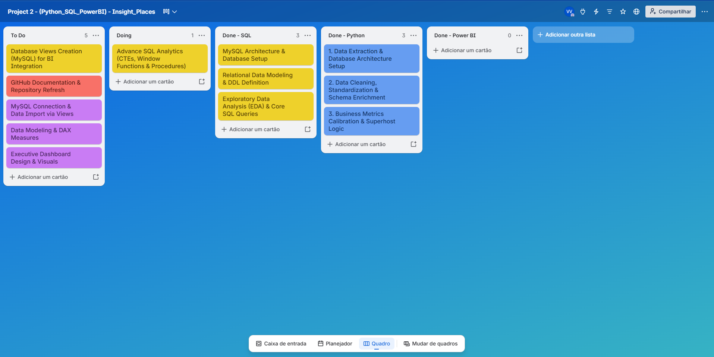

# Insight Places: Analytics Solutions & Data Pipeline 🏠📊
---

### 🌐 Select Language / Selecione o Idioma

---

## 🇬🇧 English Version

[Português](#-vers%C3%A3o-em-portugu%C3%Aas) | **English**

### 📋 Project Overview
This project simulates an end-to-end data engineering and analytics ecosystem for **Insight Places**, a fictitious vacation rental and property management platform. The primary objective is to build a robust data pipeline integrating **MySQL, Python, and Power BI**, transforming raw transactional records into an enriched relational database engineered for high-level business intelligence and strategic decision-making.

---

### 📌 Project Management & Methodology
This initiative followed the **Kanban methodology** to structure data engineering tasks, schema modifications, Python data wrangling workflows, and analytical queries.

* 📋 **Interactive Kanban Board:** [View Trello Board](https://trello.com/b/OJvRZc8H)

---

### 🛠️ Data Pipeline Architecture & Completed Stages

#### 🛢️ MySQL Architecture & Data Ingestion
* **Physical Modeling & Database Structure (DDL):** Configured the core relational database (`insight_places`) using `utf8mb4` character set and `utf8mb4_unicode_ci` collation for global character support. Enforced strict Primary Keys (PKs), Foreign Keys (FKs), and schema constraints (`NOT NULL`, `DEFAULT`, `UNIQUE`) to guarantee structural integrity.
* **Initial Data Ingestion (DML):** Bulk loaded approximately 10,000 raw records per entity across 6 relational tables (`addresses`, `bookings`, `customers`, `listings`, `owners`, `reviews`). Applied `INSERT IGNORE` logic for data idempotency and standardized all column attributes from Portuguese into business English.

#### 🐍 Python ETL & Data Wrangling
* **Data Enrichment & Synthetic Engineering:** Developed Python scripts utilizing `SQLAlchemy` and `PyMySQL` to transform and enrich raw entities with market-realistic operational metrics:
  * **`addresses`:** Added `location_type` attribute to classify property environments (e.g., Urban, Coastal, Rural).
  * **`listings`:** Added financial and physical metrics (`base_daily_rate`, `bedrooms`, `bathrooms`, `max_guests`, `description`) enabling real estate yield analytics.
  * **`bookings`:** Added behavioral fields (`booking_status`, `guests_count`, `payment_method`, `created_at`) to simulate reservation lifecycles and cancellation trends.
  * **`customers`:** Added demographic profile data (`gender`, `birth_date`, `travel_profile`, `is_identity_verified`) for customer segmentation and cohort modeling.
  * **`owners`:** Added historical profile metrics (`host_since`, `email`, `phone_number`) for host lifecycle tracking and Superhost eligibility logic.
  * **`reviews`:** Integrated relational `booking_id` FK and timestamp (`created_at`) to link feedback directly to completed stays, standardizing qualitative fields (`review_text`, `host_review`) in English for future NLP analytics.
* **ETL Pipeline & Data Governance:** Implemented automated integrity checks ($1:N$ cardinality validation, null key auditing) and secured database credentials using environment variables (`.env` via `python-dotenv`).

---

### 🔍 Future Roadmap & Upcoming Phases

#### 📊 MySQL Advanced Analytics & Data Layer
- [ ] **Advanced SQL Analytics (`01_advanced_analytics.sql`)**
  * **Goal:** Develop complex SQL analytical scripts to uncover strategic business insights regarding customer lifetime behavior, churn, host performance, and dynamic pricing strategies.
  * **Key Technical Features:**
    * **Advanced Window Functions:** Apply `LAG()` and `LEAD()` for Period-over-Period ($MoM$) comparative growth and booking interval analysis; leverage `ROW_NUMBER()` and `DENSE_RANK()` to rank top-performing hosts and flag high-demand ("star") properties vs. underperforming listings.
    * **CTEs & Conditional Aggregations:** Build multi-stage query pipelines with `WITH` clauses and conditional metrics (`CASE WHEN` + aggregations) to evaluate occupancy rates, length-of-stay distribution, and cancellation drivers.
    * **Dynamic SQL & Stored Procedures:** Automate recurring reporting tasks using parameterized Stored Procedures via `PREPARE` and `EXECUTE` statements for safe dynamic execution.
- [ ] **Database Views Creation for BI Integration (`02_create_views.sql`)**
  * **Goal:** Instantiate modular relational views (`CREATE VIEW`) to optimize query consumption, encapsulating complex joins and business logic into a clean, performant data layer for Power BI.
  * **Key Highlights:** Encapsulate multi-table CTEs and revenue KPIs; decouple presentation layer from transactional schemas to protect underlying table architecture.

#### 📈 Power BI (Executive Insights & Visualizations)
- [ ] **Direct View Connection:** Establish an optimized direct connection to MySQL analytical views.
- [ ] **Multidimensional Modeling (Star Schema):** Build dimension and fact tables, including a native calendar table (`dData`).
- [ ] **Advanced DAX Measures:** Formulate measures for total revenue, rolling occupancy rates, average daily rate (ADR), revenue per available room (RevPAR), and Yield Management.
- [ ] **Executive Dashboard Design:** Deliver interactive visual dashboards tailored for C-level executive decision-making.

---

 

---

## 🇧🇷 Versão em Português

**Português** | [English](#-english-version)

### 📋 Visão Geral do Projeto
Este projeto simula um ecossistema real de engenharia e análise de dados para a **Insight Places**, uma empresa fictícia de hospedagens e aluguel por temporada. O objetivo principal foi construir um pipeline de dados ponta a ponta integrando **MySQL, Python e Power BI**, transformando dados brutos transacionais em um banco de dados relacional enriquecido e preparado para inteligência de negócios estratégica.

---

### 📌 Gestão de Projeto & Metodologia
Esta iniciativa seguiu a **metodologia Kanban** para estruturar as tarefas de engenharia de dados, modificações de schema, rotinas de tratamento de dados em Python e consultas analíticas avançadas.

* 📋 **Quadro Kanban Interativo:** [Acessar Quadro no Trello](https://trello.com/b/OJvRZc8H)

---

### 🛠️ Arquitetura do Pipeline de Dados & Etapas Concluídas

#### 🛢️ Arquitetura MySQL & Ingestão de Dados
* **Modelagem Física e Estrutura de Banco (DDL):** Criação e configuração do banco relacional (`insight_places`) utilizando codificação `utf8mb4` e collation `utf8mb4_unicode_ci` para suporte completo a caracteres internacionais. Definição rigorosa de Chaves Primárias (PKs), Chaves Estrangeiras (FKs) e restrições de schema (`NOT NULL`, `DEFAULT`, `UNIQUE`), garantindo a integridade dos relacionamentos.
* **Carga Inicial de Dados (DML):** Ingestão massiva de aproximadamente 10 mil registros brutos por entidade em 6 tabelas relacionais (`addresses`, `bookings`, `customers`, `listings`, `owners`, `reviews`). A carga utilizou a estratégia `INSERT IGNORE` para garantir não duplicidade (idempotência), acompanhada da tradução dos atributos do português para o padrão corporativo em inglês.

#### 🐍 Python ETL & Data Wrangling
* **Enriquecimento de Dados & Engenharia Sintética:** Desenvolvimento de scripts em Python utilizando `SQLAlchemy` e `PyMySQL` para refatorar e enriquecer as entidades brutas com métricas operacionais realistas de mercado:
  * **`addresses`:** Adição do atributo `location_type` para categorizar o ambiente do imóvel (ex: Urbano, Litoral, Rural).
  * **`listings`:** Adição de atributos financeiros e físicos (`base_daily_rate`, `bedrooms`, `bathrooms`, `max_guests`, `description`) para possibilitar análises de rentabilidade imobiliária.
  * **`bookings`:** Adição de métricas comportamentais (`booking_status`, `guests_count`, `payment_method`, `created_at`) para simular o ciclo de vida das reservas e taxas de cancelamento.
  * **`customers`:** Adição de dados demográficos (`gender`, `birth_date`, `travel_profile`, `is_identity_verified`) para segmentação de clientes e análise de perfil.
  * **`owners`:** Adição de dados de histórico (`host_since`, `email`, `phone_number`) para acompanhar o tempo de casa do anfitrião e critérios de elegibilidade para Superhost.
  * **`reviews`:** Conexão relacional com a chave estrangeira `booking_id` e data (`created_at`) para vincular avaliações a estadias concluídas, padronizando os comentários (`review_text`, `host_review`) para o inglês.
* **Pipeline ETL & Governança de Dados:** Implementação de validações automatizadas de integridade (relacionamentos $1:N$, auditoria de chaves nulas) e proteção de credenciais de acesso através de variáveis de ambiente (`.env` via `python-dotenv`).

---

### 🔍 Próximos Passos & Roadmap Futuro

#### 📊 MySQL Advanced Analytics & Camada de Dados
- [ ] **Análise Avançada em SQL (`01_advanced_analytics.sql`)**
  * **Objetivo:** Desenvolver scripts SQL complexos para extrair insights estratégicos sobre comportamento de clientes, retenção (*churn*), ciclo de vida dos anfitriões e precificação dinâmica.
  * **Destaques Técnicos:**
    * **Advanced Window Functions:** Aplicação de `LAG()` e `LEAD()` para análise de crescimento comparativo período a período ($MoM$) e variação de tarifas; uso de `ROW_NUMBER()` e `DENSE_RANK()` para ranqueamento de anfitriões e identificação de anúncios "estrela" (alta demanda) vs. propriedades de baixa ocupação.
    * **CTEs & Conditional Aggregations:** Construção de pipelines de consulta em múltiplas etapas com cláusulas `WITH` e métricas condicionais (`CASE WHEN` + agregações) para cálculo de taxa de ocupação, tempo de permanência e comportamento de cancelamento.
    * **Dynamic SQL & Stored Procedures:** Automação de relatórios recorrentes via Stored Procedures parametrizadas, utilizando instruções `PREPARE` e `EXECUTE` para manipulação dinâmica de dados com total segurança.
- [ ] **Criação de Camada de Views para BI (`02_create_views.sql`)**
  * **Objetivo:** Estruturar Views relacionais (`CREATE VIEW`) para otimizar o consumo de dados, encapsulando regras de negócio complexas e servindo como uma camada limpa e performática para o Power BI.
  * **Destaques:** Encapsulamento de *joins* complexos, agregações via CTEs e KPIs de faturamento; desacoplamento da camada de relatórios em relação às tabelas transacionais.

#### 📈 Power BI (Insights Estratégicos & Visualização)
- [ ] **Conexão Direta:** Integração otimizada com as Views analíticas instanciadas no MySQL.
- [ ] **Modelagem Multidimensional (Star Schema):** Estruturação do modelo relacional (tabelas fato e dimensão) e criação de tabela de calendário nativa (`dData`).
- [ ] **Cálculos Avançados em DAX:** Desenvolvimento de medidas para faturamento total, taxa de ocupação móvel, ticket médio por reserva e *Yield Management*.
- [ ] **Executive Dashboard Design:** Construção de relatórios interativos e dinâmicos focados na tomada de decisão executiva da **Insight Places**.

